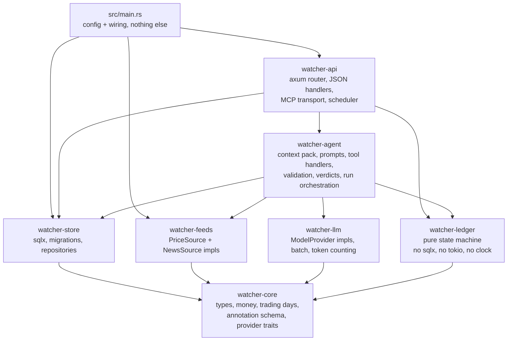
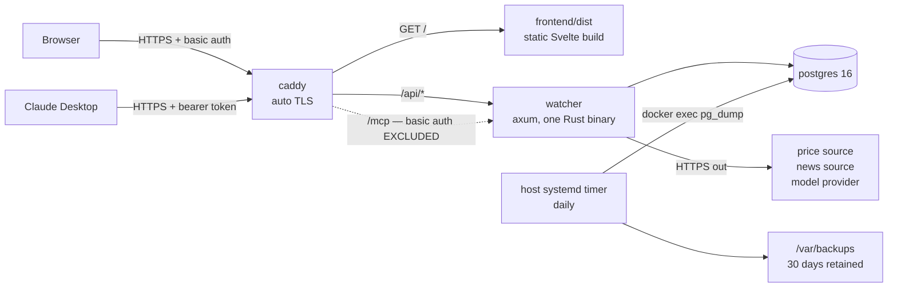
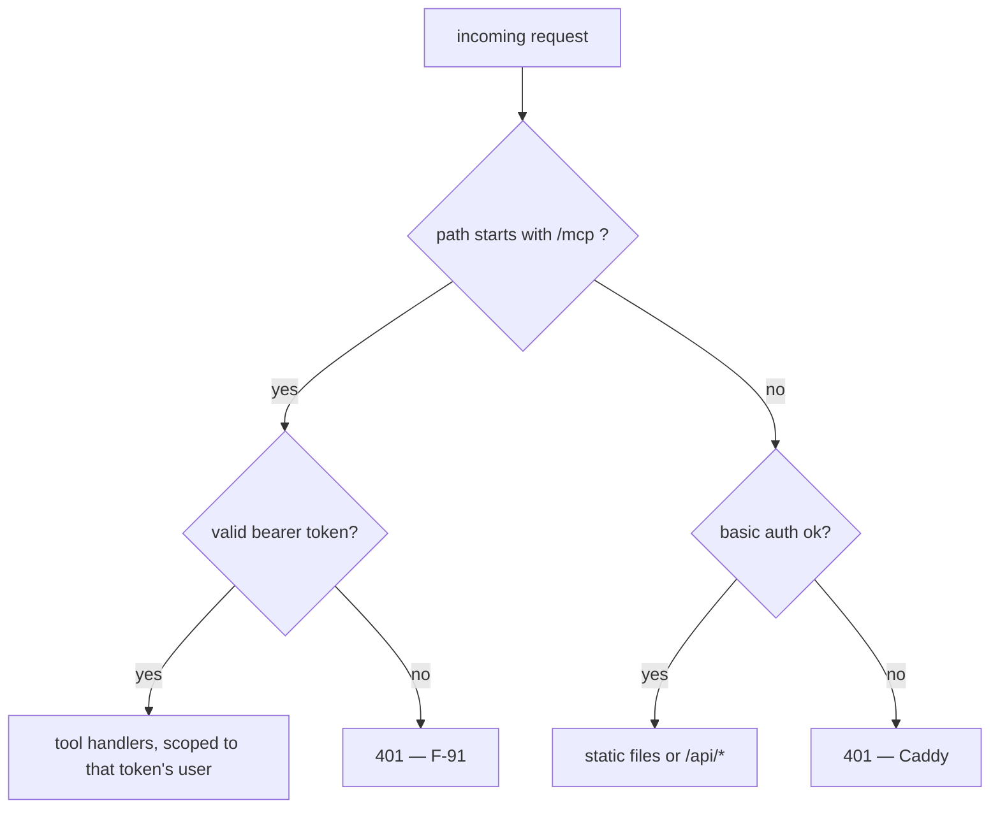
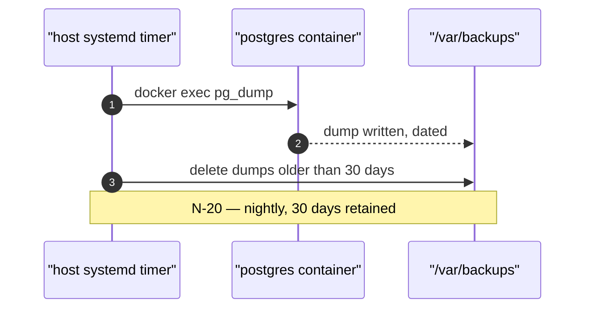

# Architecture

## Crate dependency graph

Dependencies run strictly one way. This is what makes **N-50** ("a change to one area must
not force changes in the others") and **N-54** ("swapping the price source touches no file
that deals with orders, analyses or pages") checkable by reading `Cargo.toml` rather than
by reviewing code.

Nothing depends on `watcher-api`. `watcher-ledger` depends on `watcher-core` alone, which is
what **N-56** means by "the ledger rules are testable without a database".

`src/main.rs` reaches past `watcher-api` to `watcher-store` and `watcher-feeds`, and only
there: it is the composition root, so it is the one file that opens the pool, applies the
migrations and decides which price source is live. The alternative was `watcher-api` naming a
provider itself, which is exactly the edge **N-54** exists to prevent — a handler that knows
which endpoint the prices came from. Everything below `main` is handed what it needs.

### What each crate may not do

| Crate | Forbidden |
|---|---|
| `watcher-core` | any I/O — no `sqlx`, no `reqwest`, no `tokio` |
| `watcher-ledger` | any I/O, and reading the clock. Time arrives as an argument |
| `watcher-store` | HTTP calls to providers. It talks to Postgres only |
| `watcher-api` | holding sqlx. The pool arrives as `watcher_store::Db` and every query is a function in that crate |
| `watcher-feeds` | touching analyses, orders or pages (N-54) |
| `watcher-llm` | deciding anything. It transports requests and returns responses |
| `watcher-agent` | serving HTTP. It knows nothing about axum |

## The deployed stack

One VPS, one Compose file, three services (`PLAN.md` D18).

### Why `/mcp` is excluded from basic auth

Claude Desktop authenticates with the **F-91** bearer token, not with basic auth
credentials. If Caddy guarded `/*`, the MCP endpoint would return 401 before the token was
ever read and MCP would simply never work. The exclusion is deliberate; the route is not
unprotected, it is protected by the credential **F-92** can revoke.

## Backup and restore

`pg_dump` runs from the **host**, not inside a container, on a systemd timer (**N-20**).
The consequence is that the **N-21** restore drill is rehearsed against the Compose stack
rather than a bare database — more work, and it is the one requirement that cannot be
satisfied by writing code, only by actually carrying it out and writing down what happened.

