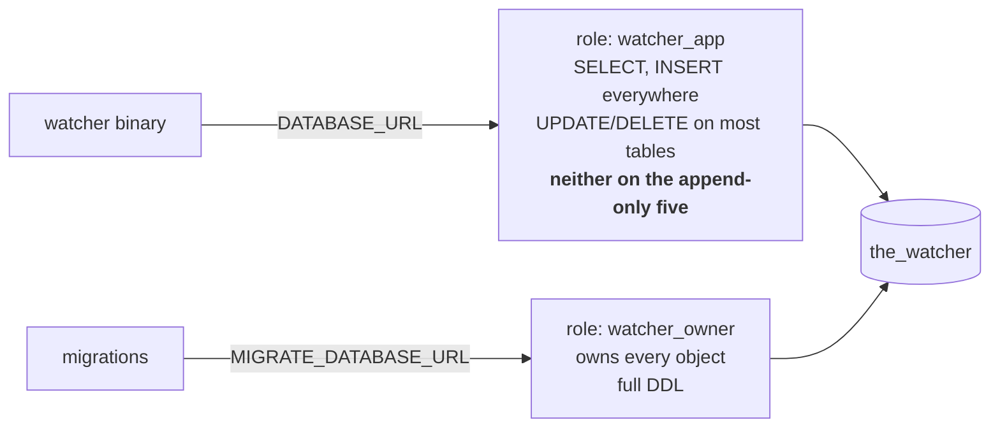
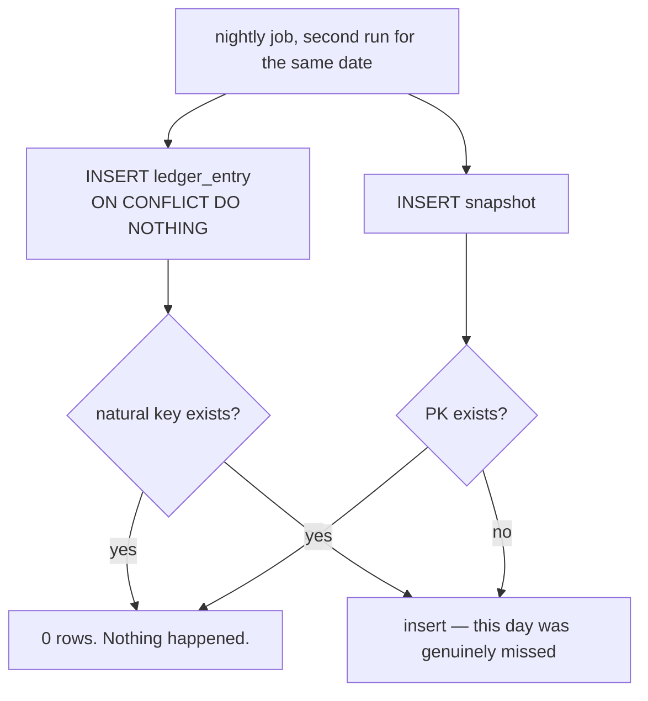

# Database

PostgreSQL 16. Forward-only versioned migrations via `sqlx` (**C-16**). Money is always
`bigint` in minor units and share counts are always `integer` — no float is stored anywhere
(**D-3**, `PLAN.md` D20).

## The two roles

This is the mechanism behind **N-1** ("the record must never be improved after the fact").
A promise that history is never rewritten is worth less than a database that cannot do it.



```sql
-- 0001_roles.sql, run as a superuser once
CREATE ROLE watcher_owner LOGIN PASSWORD :'owner_pw';
CREATE ROLE watcher_app   LOGIN PASSWORD :'app_pw';
ALTER DATABASE the_watcher OWNER TO watcher_owner;

-- at the end of every migration that creates tables:
GRANT SELECT, INSERT, UPDATE, DELETE ON ALL TABLES IN SCHEMA public TO watcher_app;

-- then take back what must never happen (D-12):
REVOKE UPDATE, DELETE ON analysis, annotation, ledger_entry,
                         news_take, raw_model_output, call_verdict
  FROM watcher_app;
```

**§11 tests this directly**: "the application database role is proven unable to update or
delete an analysis." The test connects as `watcher_app` and asserts the UPDATE is refused.
It cannot run inside a rolled-back transaction like the other store tests, so it is its own
case (`PLAN.md` D19).

## Deriving `trading_day` — and a Postgres limitation worth knowing

**D-11** says `trading_day` is never accepted as input. The obvious enforcement is a check
constraint tying it to `created_at`:

```sql
-- THIS DOES NOT WORK
CHECK (trading_day = (created_at AT TIME ZONE 'America/New_York')::date)
```

`AT TIME ZONE` with a named zone is `STABLE`, not `IMMUTABLE`, and Postgres only accepts
`IMMUTABLE` expressions in a `CHECK`. The constraint is rejected at migration time.

So the enforcement is a trigger that **overwrites** whatever was passed, which is stronger
than a check anyway — a check rejects a bad write, a trigger makes a bad write impossible:

```sql
CREATE FUNCTION set_trading_day() RETURNS trigger AS $$
BEGIN
  NEW.trading_day := (NEW.created_at AT TIME ZONE 'America/New_York')::date;
  RETURN NEW;
END $$ LANGUAGE plpgsql;

CREATE TRIGGER analysis_trading_day BEFORE INSERT ON analysis
  FOR EACH ROW EXECUTE FUNCTION set_trading_day();
```

Combined with no UPDATE for `watcher_app`, there is then no path that writes an analysis
with any day but today's — which is exactly what **N-1**'s acceptance test asks for.

### The one exception

A `ledger_entry` for a corporate action takes its day from the corporate action record,
because a dividend is credited on its **pay date** (**F-71**) and may be processed later
than that. The trigger on `ledger_entry` is conditional:

```sql
IF NEW.corporate_action_id IS NOT NULL THEN
  NEW.trading_day := (SELECT pay_date FROM corporate_action WHERE id = NEW.corporate_action_id);
ELSE
  NEW.trading_day := (NEW.created_at AT TIME ZONE 'America/New_York')::date;
END IF;
```

Without this, a dividend processed on Monday for Friday's pay date lands on Monday and the
ledger stops agreeing with the snapshot series (**F-80**). The exception is open to
corporate-action entries and nothing else.

## Idempotency: the natural key

**F-101** says running the nightly job twice for one day has the same result as running it
once. **D-13** makes that a property of the schema rather than something the job must get
right:

```sql
ALTER TABLE ledger_entry
  ADD CONSTRAINT ledger_entry_natural_key
  UNIQUE (portfolio_id, trading_day, kind, subject_id);
```

Every write is `INSERT ... ON CONFLICT DO NOTHING`. A second run inserts nothing and
changes nothing. `snapshot` gets the same protection from its primary key
`(portfolio_id, trading_day)`.



That second branch matters: it is also how **N-22** works. A job that failed yesterday
catches up today, because the only thing stopping a write is a row already being there.

## Table detail

Only the columns that carry a decision are listed. Every table has `created_at
timestamptz NOT NULL DEFAULT now()`.

### `analysis` — append only

| Column | Type | Notes |
|---|---|---|
| `id` | `text` PK | `as_` + ULID |
| `run_id` | `text` NOT NULL | FK `run` |
| `instrument_id` | `bigint` NOT NULL | FK `instrument` |
| `trading_day` | `date` NOT NULL | **trigger-set**, never input |
| `version` | `int` NOT NULL | increments per ticker per day (**F-14**) |
| `trigger` | `text` NOT NULL | `scheduled` \| `manual`. **F-17** scores only `scheduled` |
| `summary` | `text` NOT NULL | three to five sentences (**F-20**) |
| `data_cutoff_bar` | `date` NOT NULL | latest price bar it saw |
| `data_cutoff_news` | `timestamptz` | newest news item it saw |

```sql
UNIQUE (instrument_id, trading_day, version)
CHECK  (trigger IN ('scheduled','manual'))
CHECK  (version >= 1)
```

### `annotation` — append only

| Column | Type | Notes |
|---|---|---|
| `kind` | `text` NOT NULL | one of six (**F-21**) |
| `price` | `bigint` | minor units. Levels and stops |
| `zone_low`, `zone_high` | `bigint` | zones only |
| `mark_date` | `date` | `breakout` and `event` only |
| `reason` | `text` NOT NULL | **F-22**, no annotation without one |
| `flagged` | `boolean` NOT NULL DEFAULT false | **F-23**, far from last close |

```sql
CHECK (kind IN ('support','resistance','entry_zone','stop','breakout','event'))
CHECK (price IS NULL OR price > 0)                          -- F-23
CHECK (zone_low IS NULL OR zone_high IS NULL OR zone_low <= zone_high)
CHECK (kind NOT IN ('breakout','event') OR mark_date IS NOT NULL)
CHECK (mark_date IS NULL OR mark_date <= trading_day)       -- no future dates
CHECK (length(btrim(reason)) > 0)
```

The database repeats what the validator in `watcher-agent` already checks. That is
intentional: the validator produces a message the model can act on (**I-3**), the
constraint guarantees nothing slips past it.

Note what is **not** here: a price far from the last close is *stored and flagged*, never
rejected (**F-23**, **C-20**). The threshold is a configured percentage, not a constraint.

### `ledger_entry` — append only

| Column | Type | Notes |
|---|---|---|
| `kind` | `text` NOT NULL | `fill` \| `fee` \| `dividend` \| `split` \| `reversal` |
| `subject_id` | `text` NOT NULL | the order, action or entry it concerns |
| `trading_day` | `date` NOT NULL | trigger-set, with the corporate-action exception |
| `cash_delta` | `bigint` NOT NULL | minor units, signed. 0 for a split |
| `share_delta` | `integer` NOT NULL | signed. 0 for a dividend |
| `corporate_action_id` | `text` | set only for `split` and `dividend` |

A correction is a new `reversal` entry, never an edit (**D-2**).

### `call_verdict` — append only

| Column | Type | Notes |
|---|---|---|
| `subject_kind` | `text` NOT NULL | `annotation` \| `order` |
| `subject_id` | `text` NOT NULL | polymorphic, see `entities.md` |
| `as_of` | `date` NOT NULL | the day the verdict was computed |
| `status` | `text` NOT NULL | `provisional` \| `final` |
| `verdict` | `text` NOT NULL | the judgement in words |

```sql
UNIQUE (subject_kind, subject_id, as_of)   -- one verdict per call per day
CHECK  (subject_kind IN ('annotation','order'))
CHECK  (status IN ('provisional','final'))
```

Appending rather than updating is what lets the page show a verdict *firming up* instead of
appearing finished on day 30 (**F-84**).

## Indexes

Each one exists for a named query. No speculative indexes.

| Index | Serves |
|---|---|
| `price_bar (instrument_id, bar_date)` — PK | chart range queries, **N-10** |
| `analysis (instrument_id, trading_day DESC, version DESC)` | **F-15**, newest shown |
| `analysis (instrument_id, trading_day) WHERE trigger = 'scheduled'` | **F-17**, scoring |
| `annotation (analysis_id)` | drawing a chart |
| `news_item (instrument_id, published_at DESC)` | **F-40**, newest first; **F-42** window |
| `ledger_entry (portfolio_id, trading_day)` | portfolio reconstruction |
| `ledger_entry (portfolio_id, trading_day, kind, subject_id)` — UNIQUE | **F-101** |
| `snapshot (portfolio_id, trading_day)` — PK | equity curve, **F-80** |
| `call_verdict (subject_kind, subject_id, as_of DESC)` | decision log, **F-83** |
| `model_call (user_id, trading_day)` | the **N-30** cap check, read before every run |
| `paper_order (portfolio_id, state) WHERE state = 'pending'` | the fill pass |

## Migration order

Forward only. A migration is never edited after it has run anywhere.

| # | File | Contents |
|---|---|---|
| 0001 | `roles.sql` | the two roles, ownership |
| 0002 | `core.sql` | `app_user`, `api_token`, `instrument`, `watchlist_item`, `portfolio` |
| 0003 | `calendar.sql` | `trading_calendar` **plus its seed data**, 2026–2030 (**D-15**) |
| 0004 | `market_data.sql` | `price_bar`, `corporate_action`, `news_item` |
| 0005 | `runs.sql` | `run`, `analysis`, `annotation`, `raw_model_output`, `news_take`, the `set_trading_day` trigger |
| 0006 | `ledger.sql` | `paper_order`, `position`, `ledger_entry`, `snapshot`, `benchmark_basket` |
| 0007 | `verdicts.sql` | `call_verdict` |
| 0008 | `chat_cost.sql` | `chat_message`, `model_call` |
| 0009 | `grants.sql` | grants, then the **D-12** revokes. **Last, so it covers everything** |

0003 carrying its own seed data is deliberate: the calendar is reference data, not fixtures.
**N-3** ("a run on Thanksgiving completes and records no fills") and the `trading_day`
trigger both need a calendar that tests can rely on and that cannot change under them at
runtime.

0009 being last matters. A grant written inside each table's migration drifts the moment
someone adds a table and forgets; one grants migration at the end, re-run as the schema
grows, cannot.

## Retention

| Data | Kept | Requirement |
|---|---|---|
| `analysis`, `annotation` | **indefinitely** | D-6 — they are the product |
| `price_bar` | at least 5 years | D-7 |
| `news_item` | shown for 14 days, stored longer | F-42 |
| backups | 30 days | N-20 |
