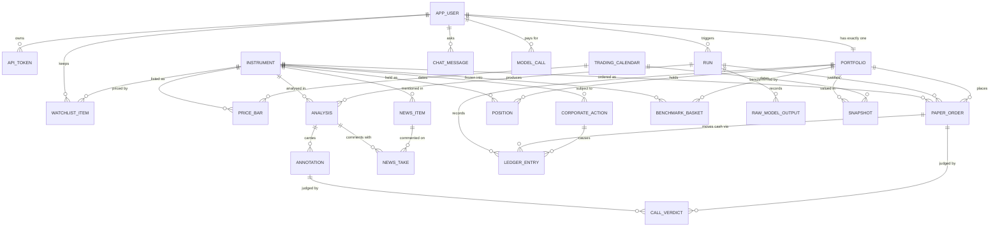
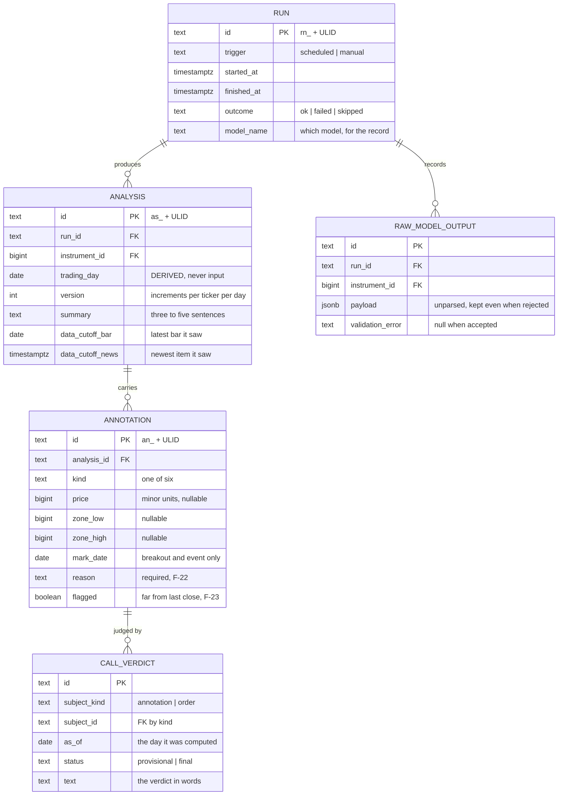

# Entities

Twenty-two entities. Columns live in [`database.md`](database.md); this file is about what
exists and how it relates.

Two tables are renamed from the requirements' entity names because the originals are SQL
reserved words: `user` → **`app_user`**, `order` → **`paper_order`**.

## The whole model

## The append-only core

This is the product. Five tables the application can insert into and can never change,
because the `watcher_app` role holds no UPDATE or DELETE on them (**D-12**, `PLAN.md` D7).

`CALL_VERDICT` points at two possible parents by `subject_kind`, so it carries no foreign
key. That is a deliberate trade: a polymorphic reference loses database-enforced integrity,
and the alternative — two near-identical verdict tables — loses the single query the
decision log needs. Integrity is covered by a `CHECK` on `subject_kind` plus the test in
`doc/ledger.md`.

## Reference

| Entity | Purpose | Key | Writes | Requirement |
|---|---|---|---|---|
| `app_user` | owner of a watchlist and portfolio. **One row in v1** | `id` | update | D-1 |
| `api_token` | hashed MCP token. Never stored in clear | `id` | update, delete | F-92, N-41 |
| `instrument` | validated tickers, US-listed only | `id` | update | F-1, C-11 |
| `watchlist_item` | one *membership period* per row, so add/remove/re-add keeps all three | `(user, instrument, added_on)` | update | F-1, F-3 |
| `trading_calendar` | US sessions and half-days, 2026–2030 | `cal_date` | seed only | D-15 |
| `price_bar` | **raw** daily OHLCV. Never adjusted | `(instrument, bar_date)` | insert | I-11, D-7 |
| `corporate_action` | splits and dividends, with pay dates | `id` | insert | F-70, F-71 |
| `news_item` | headline, source, timestamp, URL. **No article text** | `id` | insert | I-20, I-21 |
| `news_take` | the agent's one line per item | `id` | **append only** | F-41 |
| `run` | one pass: trigger, times, outcome, model | `id` | update outcome | F-12 |
| `analysis` | summary, cutoff, version per ticker per day | `id` | **append only** | F-14, D-6 |
| `annotation` | one structured mark with its reason | `id` | **append only** | F-21, F-22 |
| `raw_model_output` | the model's unparsed response | `id` | **append only** | D-14 |
| `call_verdict` | verdict about one call, as of a day | `id` | **append only** | F-84 |
| `portfolio` | cash in minor units, created date | `id` | update cash | F-60 |
| `position` | shares held per ticker | `(portfolio, instrument)` | update | F-69 |
| `paper_order` | order with its run reference and state | `id` | update state | F-61, F-62 |
| `ledger_entry` | every cash and share movement | `id` + natural key | **append only** | D-2, D-13 |
| `benchmark_basket` | **frozen** share counts at creation | `(portfolio, instrument)` | insert | F-82 |
| `snapshot` | daily cash, positions, equity | `(portfolio, trading_day)` | insert | F-80 |
| `chat_message` | question and answer per ticker | `id` | insert | F-50 |
| `model_call` | tokens in and out, cost, latency | `id` | insert | F-95, N-61 |

## Identifiers

Opaque ULIDs stored as `text`, with a three-character type prefix — `rn_`, `as_`, `an_`,
`or_`, `le_`. This is what the chart contract in `PLAN.md` already shows on the wire.

- **Time-ordered**, so insertion order is index order without a separate sequence.
- **Opaque**, so an id does not leak how many records exist. **N-43** is still enforced by
  scoping every query to the owner — opaque ids are not the control, just not a hint.
- **Debuggable**, because the prefix says what you are looking at in a log line.

Where a natural key exists it is used instead, and there is no surrogate id at all:
`price_bar`, `snapshot`, `position`, `benchmark_basket`, `watchlist_item`,
`trading_calendar`. One fewer column and one fewer way to insert a duplicate.

The two seeded rows — the single v1 user and their portfolio — use all-zero ids of the right
length (`us_` plus 26 characters). They sort before any real ULID, which is correct for the
first rows, and they would survive a format check if one is ever added. See `REVIEW.md`,
finding 6.

## What is deliberately absent

There is **no column anywhere** for income, savings, risk tolerance or investment goals.
**D-8** and **C-2** are not preferences: collecting those and then naming an instrument is
what makes a product Anlageberatung under German law. The schema has no field for them, so
no code path can start storing them by accident.
