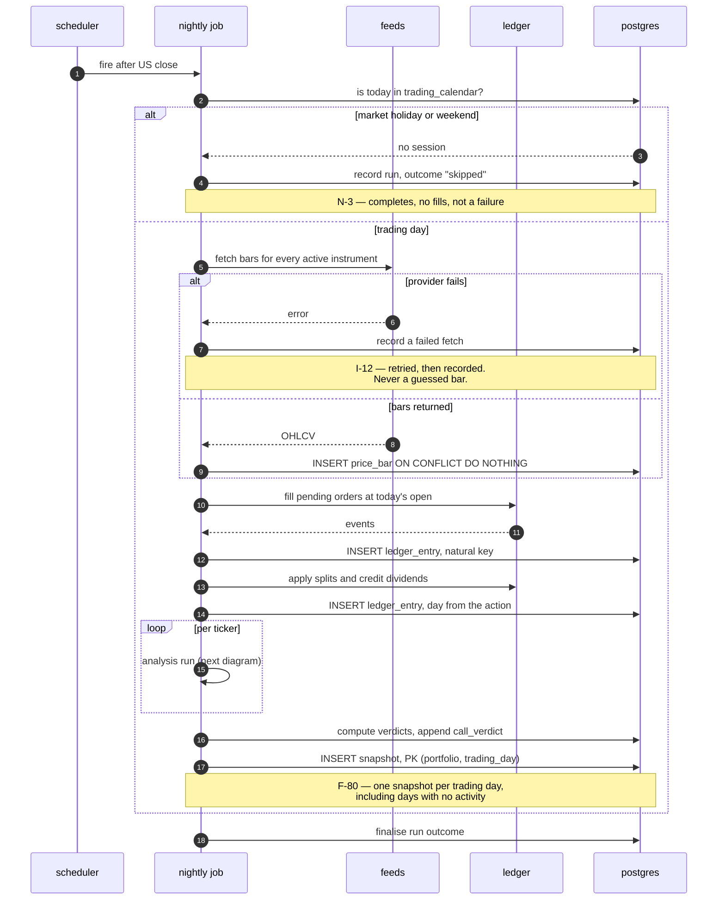
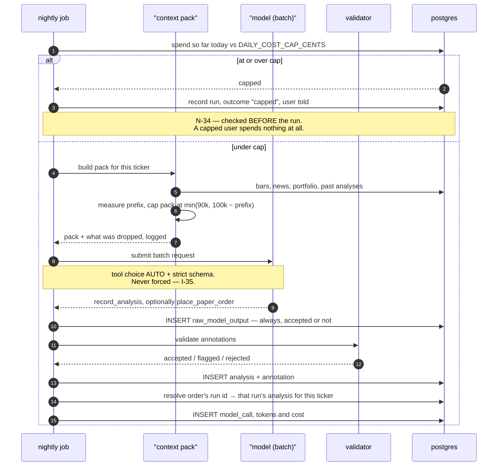
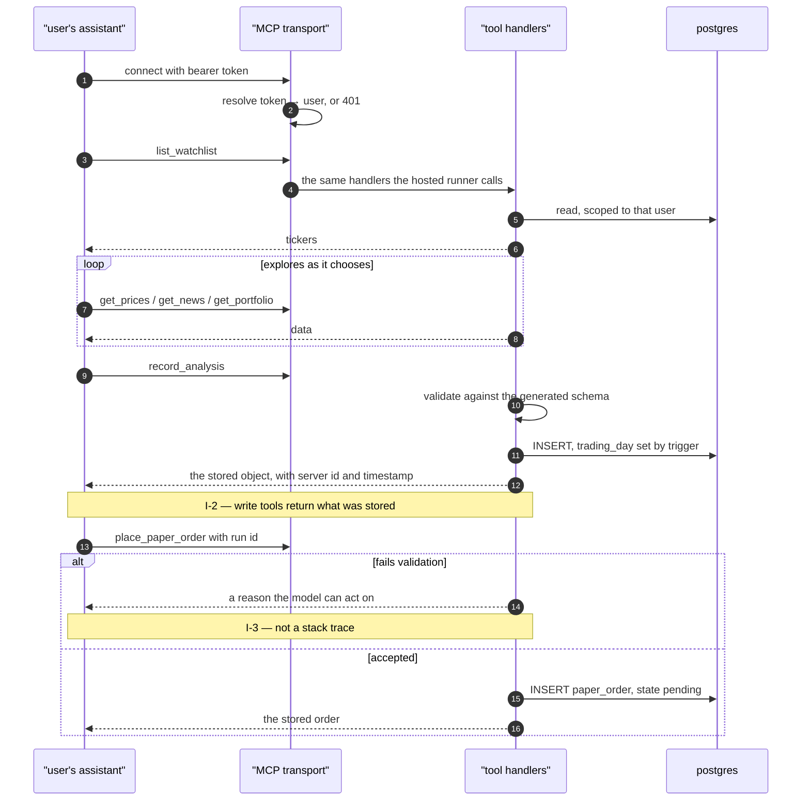
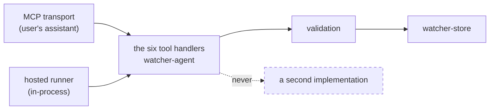
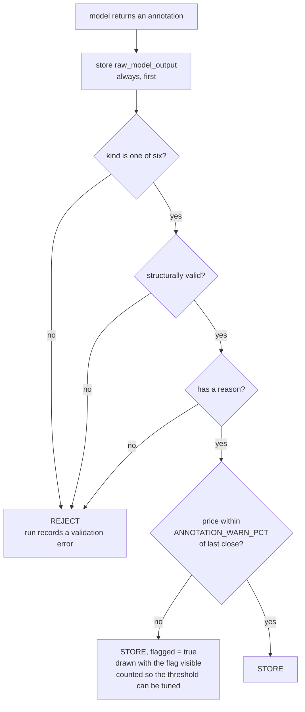
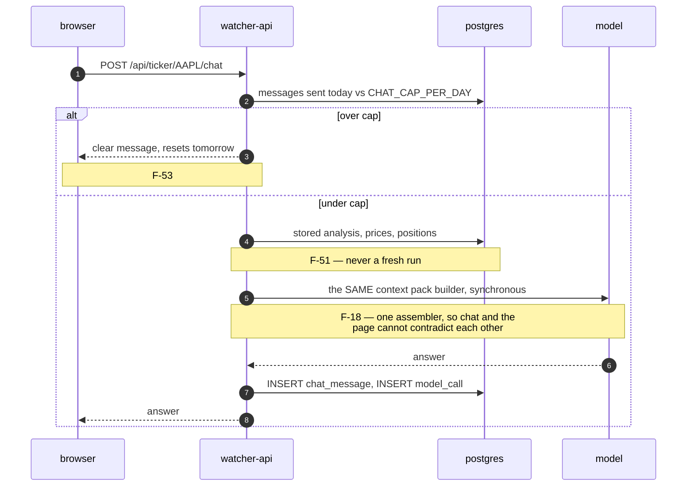
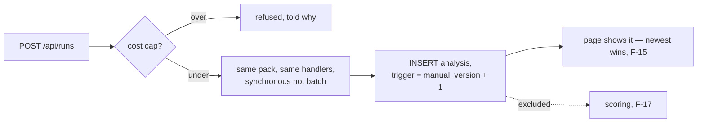

# Flows

How a day actually passes. Order lifecycle and verdict rules live in
[`ledger.md`](ledger.md).

## The nightly job

Fires after the US close. Idempotent by construction (**F-101**), and it recovers on its
own: a day missed yesterday is written today, because the only thing stopping a write is a
row already being there (**N-22**).

**F-13** (partial failure) is the `loop per ticker` step: one ticker failing records a
failure and the other nineteen still complete. A run over twenty tickers where one symbol
has no data stores nineteen analyses and one recorded failure.

## A hosted run — single shot

One context pack in, one answer out, through the provider's asynchronous batch route
(**F-97**, **I-33**). Nobody is waiting on a job that starts after the close, and the batch
discount is large.

The order carries a **run id**, not an analysis id (`PLAN.md` D9). A single-shot agent
emits its analysis and its order in the same turn and cannot cite an id the server has not
assigned yet. The server resolves run + ticker to the one analysis that run produced.

## A connected agent — over MCP

The user's own assistant, paying with its own tokens. It can explore across several calls,
which makes it **more** capable than the hosted runner, not less — and **F-97** obliges us
to say so plainly rather than imply parity.

### Why there is one set of handlers

**F-96** requires that the hosted agent has exactly the tools a user's own agent has, with
the same validation. One implementation makes that structural — there is no second code
path that could drift.

Parity is a claim about **what may be written and what is checked**. It is not a claim
about reach: a hosted run never calls the four read tools, because the context pack already
supplies what they would have returned.

## Annotation validation

Three outcomes, not two. A price far from the last close is **stored and flagged**, never
rejected — the threshold starts at 25% and is a value chosen to be revised (**C-20**), which
is only possible because every raw payload is kept (**D-14**).

"Structurally valid" means: a positive numeric price, a zone whose low is not above its
high, a date present on `breakout` and `event`, and no date in the future (**F-23**).

The schema the model is given and the schema the validator checks are **generated from one
definition** in `watcher-core` (**N-55**), so they cannot disagree. An unknown kind is a
deserialization error before any of this runs.

## Chat

Grounded in what is already stored. Reading a page never costs money (**N-11**); asking a
question does, which is why it is capped.

### What chat must refuse

**F-54** and **C-2**: the assistant refuses questions asking what the user personally should
do with their money, and never asks for personal financial circumstances. "Should I put my
savings into this?" gets a refusal plus general information.

This is not a politeness setting. A personal recommendation on a named instrument, based on
personal circumstances, is Anlageberatung under § 1 Abs. 1a S. 2 Nr. 1a KWG, and BaFin
states that automating it changes nothing. There is also no column to store the answer in
(see `entities.md`).

## Manual run

**F-11** lets the user trigger a run for one ticker or the whole watchlist. It uses the same
pack and the same handlers, synchronously rather than through batch, and is recorded with
`trigger = 'manual'`.

Ten manual reruns in one day do not change the track record for that day (**F-17**), and
tomorrow's scheduled run replaces the view naturally — there is no decay rule to write
(closed **O-8**).
