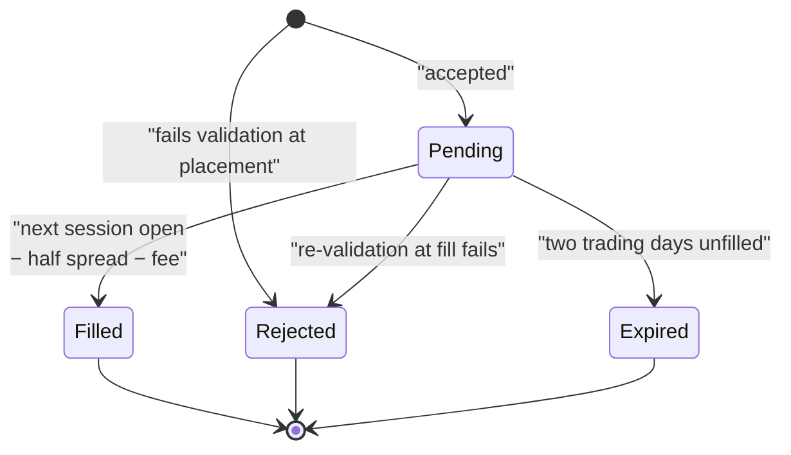
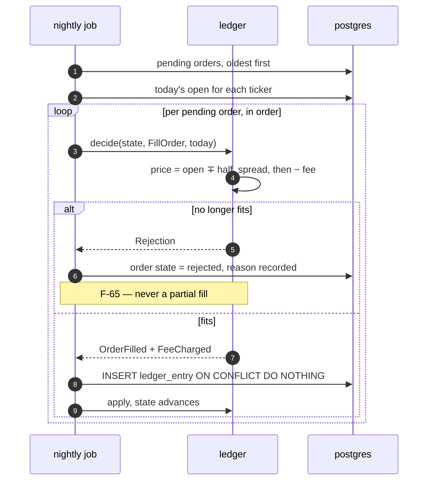
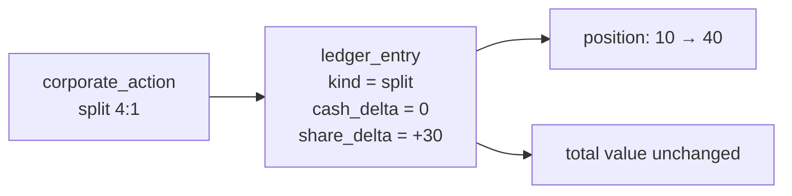
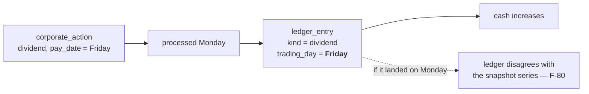
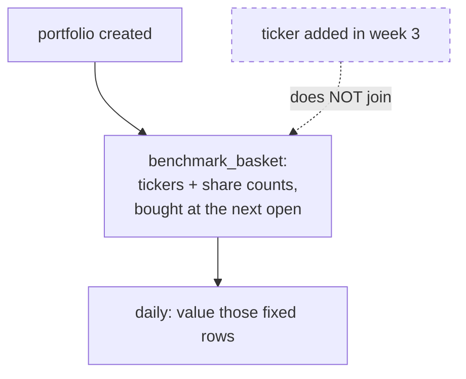
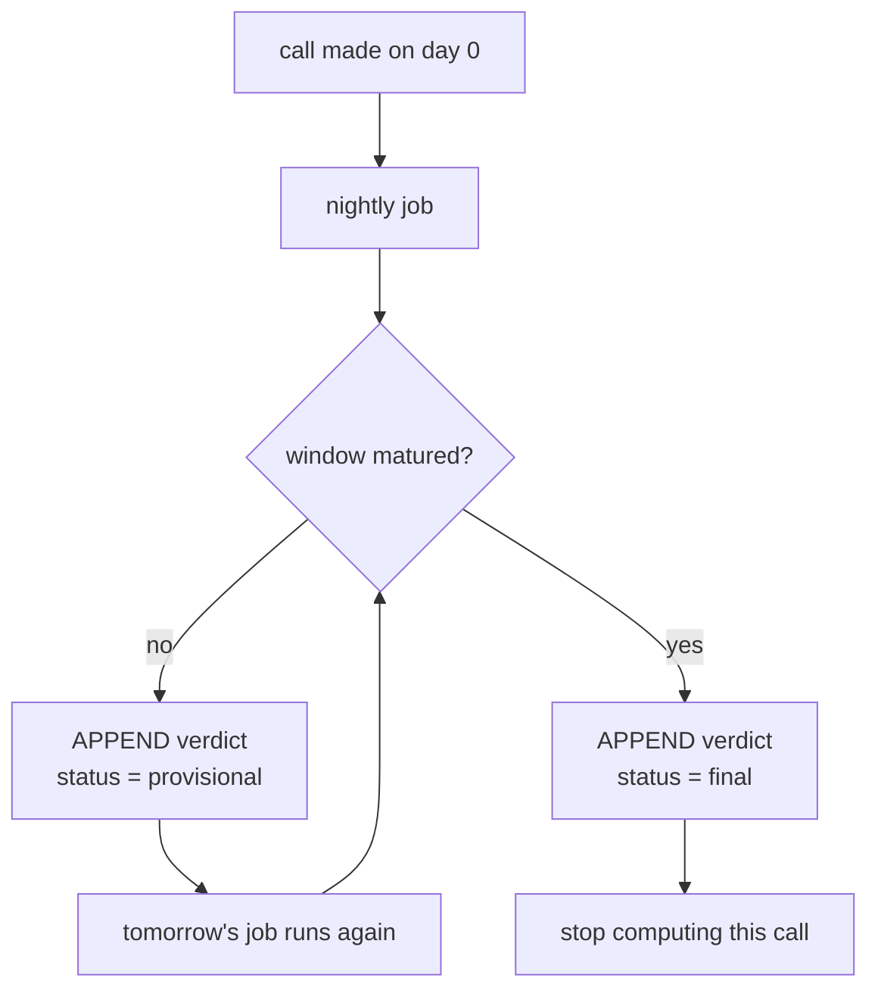

# Ledger

The paper trading rules, and how a call gets scored. `watcher-ledger` is a pure state
machine: no sqlx, no tokio, no clock of its own — time arrives as an argument. The six
**N-53** tests therefore run with no Postgres present (**N-56**).

```rust
pub fn decide(state: &PortfolioState, cmd: Command, day: TradingDay)
    -> Result<Vec<Event>, Rejection>;

pub fn apply(state: &mut PortfolioState, event: &Event);
```

`decide` never writes. `apply` never fails. Storage turns events into `ledger_entry` rows
with their natural key, and that is the only place the database is involved.

## Order lifecycle



### Validation at placement (**F-63**)

Each failure returns a distinct reason the model can read (**I-3**):

| Check | Requirement |
|---|---|
| ticker is in the instrument list | F-63 |
| quantity is a positive **whole** number | F-67 |
| the order carries **no price field** | F-61 |
| enough cash for a buy | F-63 |
| enough shares held for a sell — **no shorting** | F-68 |
| references a run that produced an analysis for this ticker | F-62 |

### Fill at the next open (**F-64**)



Two details that are easy to get wrong:

- **Order matters.** Three buys that each fit alone but not together must fill until the
  cash runs out, then reject — not all three, and not none (**F-65**). Pending orders are
  processed oldest first, and `apply` advances the state between each one, so the fourth
  decision sees the first three's effects.
- **Costs are subtracted, never added back.** A buy fills at `open + half_spread`, a sell at
  `open − half_spread`, and both then pay the flat fee. 5 bps and 1 USD, configurable
  (**C-19**). The record cannot flatter itself.

### Expiry (**F-66**)

An unfilled order expires after two trading days and the agent is told. A halted ticker is
the normal cause.

## Corporate actions

### Splits (**F-70**)

An explicit ledger entry, never a silent adjustment. After a 4-for-1 split, 10 shares at
400 become 40 shares at 100 and total value is unchanged.



Prices stay **raw** in `price_bar` (**I-11**). Adjusted prices are never the source of
truth, because they change retroactively — and a record that changes retroactively is the
one thing this product exists not to have.

### Dividends (**F-71**)

Credited on the **pay date**, as their own entry, with no reinvestment. This is the single
exception to the derived-trading-day rule; see [`database.md`](database.md).



## Snapshots and the benchmark

### Daily snapshot (**F-80**)

One row per portfolio per trading day, **including days with no activity**. Fourteen trading
days produce fourteen rows whatever the agent did — that is what makes the 14-day
acceptance test meaningful.

**F-69** must reconcile: cash plus position values equals the equity in the latest snapshot.

### The frozen basket (**F-82**)

The benchmark is equal-weight buy-and-hold of the watchlist **as it stood when the
portfolio was created**, bought at the next open, never rebalanced.



Storing the basket rather than deriving it is the whole point. **F-82**'s acceptance test is
that adding a ticker in week three does not change the benchmark line in week one. Computing
it from the current watchlist at read time would silently rewrite history, and nobody would
notice until the chart was already wrong.

## Verdicts

**F-84**, raised to Must in requirements v1.2. The brief's central bet is that people will
open an old analysis — and a list of old analyses is a log, not a track record. What makes
someone open it is a judgement.

### The rules

Falsifiable, defined per mark kind, computed by the nightly job:

| Kind | Rule |
|---|---|
| `support` | broke if any close falls below the level within 30 trading days |
| `resistance` | broke if any close rises above the level within 30 trading days |
| `entry_zone` | touched if any bar's range overlaps the zone; then the close 30 days after first touch |
| `stop` | hit if any low reaches the level within 30 trading days |
| `breakout` | confirmed if two consecutive closes sit beyond the level within 10 trading days |
| `event` | **no verdict** |
| order | return since fill at 7, 30 and 90 trading days, beside the benchmark over the same windows |

### Why `event` gets no verdict

An `event` marker says "this happened here". It is not a claim about what the price will do,
so scoring it would be inventing a prediction the agent never made in order to then grade
it. That is the kind of flattery the whole product exists to avoid.

### Provisional, then final



Each recomputation **appends** a row keyed `(subject_kind, subject_id, as_of)`. Nothing is
updated, which keeps **D-12** intact — the annotation stays immutable and the application
role could not edit it in any case.

The side effect is better than the requirement asked for: a user watching a position sees
the verdict firm up day by day, rather than a judgement appearing complete on day 30 with
no visible history. "Held so far, 7 of 30 days" is a more honest sentence than silence.

## What the tests must cover

The six **N-53** cases, all without a database:

| Test | Asserts |
|---|---|
| fill at next open | Friday evening order fills at Monday's open, costs subtracted |
| insufficient cash | three buys that fit alone but not together fill until cash runs out, then reject |
| split | 10 @ 400 becomes 40 @ 100, total value unchanged |
| dividend | own entry, cash increases, dated to the pay date |
| expiry | unfilled after two trading days, agent told |
| double run | the same day twice produces one fill and one snapshot |

Plus, needing a database and therefore living in `watcher-store`: the **D-12** role test
(`watcher_app` cannot UPDATE an `analysis`) and the **F-101** job-level idempotency test.
